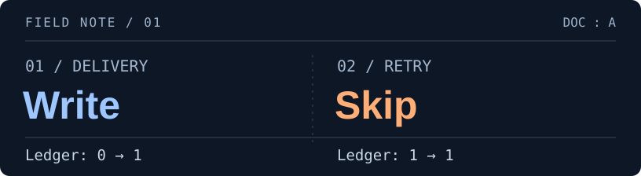

# Roberto Braga

Applied AI & Automation Engineer at Cubic³, based in Brazil. I build workflows that can explain **why they acted, why they stopped, and what a person should review**. My research asks a related question: what does a model forget after an update?

## Workflow Replay Lab

A document arrives twice. Should the second delivery write another record? The lab lets you replay both events against the same ledger and inspect the reason for each decision.

**[Run the replay →](https://betobraga.github.io/workflow-replay-lab/)** · [Inspect the source and tests](https://github.com/BetoBraga/workflow-replay-lab)

Inside the experiment: four fictional cases

The first delivery writes a record; the retry skips it. A missing piece of evidence and an unreadable PDF each route to human review. The ledger lives in memory: no uploads, API key, real document parsing, or enterprise integrations.

## Two more questions from my work

**[ContinualKit](https://github.com/BetoBraga/continualkit) · What changed after training?**

An early-stage Python toolkit for measuring mean forgetting across tasks. An overall score can hide a regression on a task the model used to handle.

**[EagleEye](https://github.com/BetoBraga/eagle-eye) · What did the detector see?**

A Streamlit and Detectron2 app for inspecting model output, annotating images, and exporting annotations.

---

**Have a replay case?** [Suggest one](https://github.com/BetoBraga/workflow-replay-lab/issues) with a fictional input and the decision you would expect. A revised document that looks like a duplicate is a good place to start.

[Portfolio & background ↗](https://borerto.com/)
