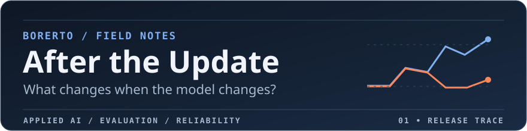
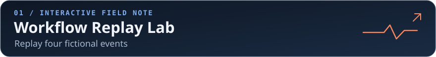
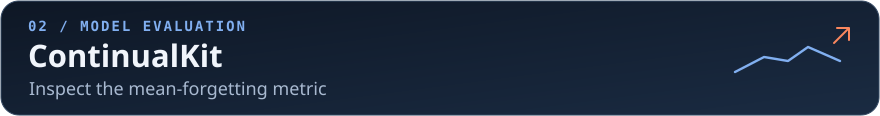

# Roberto Braga

<picture>
  <source media="(prefers-color-scheme: dark)" srcset="./assets/flight-recorder-dark.svg">
  <source media="(prefers-color-scheme: light)" srcset="./assets/flight-recorder-light.svg">
  
</picture>

## I build AI systems for the moments when the happy path ends.

I'm an Applied AI & Automation Engineer at Cubic³, based in Brazil. I work on LLM evaluation and service automation. A score should tell you what broke. A workflow should tell you why it declined to act.

[Run the demo](#run-the-field-note) · [Selected projects](#selected-projects) · [Contribute a case](#contribute-a-case) · [borerto.com](https://borerto.com/)

## Run the field note

<a href="https://betobraga.github.io/workflow-replay-lab/">
<picture>
  <source media="(prefers-color-scheme: dark)" srcset="./assets/replay-card-dark.svg">
  <source media="(prefers-color-scheme: light)" srcset="./assets/replay-card-light.svg">
  
</picture>
</a>

Replay four fictional events and see why a workflow writes, skips, or routes to a human. No sign-in, API key, or uploads. [Run the demo](https://betobraga.github.io/workflow-replay-lab/) · [Read the source and tests](https://github.com/BetoBraga/workflow-replay-lab)

What can I test in the demo?

A first delivery, a retry, missing evidence, and an unreadable PDF. The demo simulates decisions with fictional data and an in-memory ledger. It does not parse real documents or connect to enterprise systems.

## Selected projects

<a href="https://github.com/BetoBraga/continualkit">
<picture>
  <source media="(prefers-color-scheme: dark)" srcset="./assets/continual-card-dark.svg">
  <source media="(prefers-color-scheme: light)" srcset="./assets/continual-card-light.svg">
  
</picture>
</a>

**[ContinualKit](https://github.com/BetoBraga/continualkit).** What does a model forget after an update? An early-stage Python toolkit for measuring mean forgetting across tasks.

<a href="https://github.com/BetoBraga/eagle-eye">
<picture>
  <source media="(prefers-color-scheme: dark)" srcset="./assets/eagle-card-dark.svg">
  <source media="(prefers-color-scheme: light)" srcset="./assets/eagle-card-light.svg">
  
</picture>
</a>

**[EagleEye](https://github.com/BetoBraga/eagle-eye).** How can a person inspect a vision model's output? A Streamlit and Detectron2 app for image annotation and export.

## Contribute a case

Found an edge case worth testing? [Propose a fictional replay case](https://github.com/BetoBraga/workflow-replay-lab/issues) with the smallest input that reproduces it and the decision you'd expect. Start with a retry, a missing source, or a new revision that looks like a duplicate.
