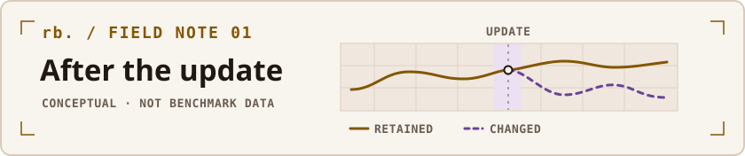

# Roberto Braga

## What changes when the model changes?

I’m an Applied AI & Automation Engineer at Cubic³. I work on LLM evaluation and service automation, where retries, missing evidence, and human review shape what a workflow can reliably do.

<picture>
  <source media="(prefers-color-scheme: dark)" srcset="./assets/model-change-dark.svg">
  <source media="(prefers-color-scheme: light)" srcset="./assets/model-change-light.svg">
  
</picture>

### Start here

**[ContinualKit](https://github.com/BetoBraga/continualkit)** 
What does a model retain after an update? An early-stage toolkit for exploring continual learning and regression in LLMs.

**[EagleEye](https://github.com/BetoBraga/eagle-eye)** 
A Streamlit app that uses Detectron2 to annotate images and export the result.

[borerto.com](https://borerto.com/)
