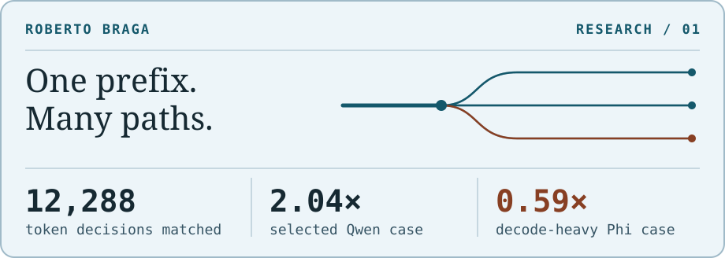

# Roberto Braga

**Applied AI & Automation Engineer · Cubic³ · Brazil**

> Good software gives people a way to disagree.

I work on model evaluation and service automation. What I want from an AI system is simple: show me what changed, give me something I can test, and let me stop it when the evidence isn't there.

<picture>
  <source media="(prefers-color-scheme: dark)" srcset="assets/evidence-register-dark.svg">
  
</picture>

## Selected work

### Stochastic Provenance

If a model reads the same prompt 32 times to give you 32 answers, which work can you skip? You can read it once. The trick is making sure each answer still gets its own random draws.

Prefix caching saves work. I wanted a way to tell if it had also changed the experiment. This project gives each path its own draws, then checks the token choices against a reference. Whether it uses less time or memory is a separate test.

**Enough buzzwords. Here are the receipts.** All **12,288 token decisions** matched in the tested matrix. On one RTX 5060 Ti, a selected Qwen workload ran at **2.04×** the baseline speed with **46.7% less peak allocated GPU memory**. A decode-heavy Phi run still saved **28.2%** of that memory but took **about 70% longer**. Same question, different workload, different answer.

**[Read the study](https://betobraga.github.io/stochastic-provenance/)** · [Run the CPU demo](https://github.com/BetoBraga/stochastic-provenance#03--run-in-under-a-minute) · [Check the evidence](https://github.com/BetoBraga/stochastic-provenance/blob/main/docs/evidence.md)

### More things you can try

| Project | Question it tests | Start here |
| :-- | :-- | :-- |
| Workflow Replay Lab | When a document is delivered twice, does it create two records? | [Replay a case](https://betobraga.github.io/workflow-replay-lab/) |
| ContinualKit | Did a model update break a task the old version could do? | [See the evaluation toolkit](https://github.com/BetoBraga/continualkit) |

<strong>What would make me hold a release?</strong>

A better average can hide a regression on a critical task. A fluent answer can cite a source that doesn't support it. A retry can quietly create a second record. Each needs its own test, and any one of them can be a reason to wait.

**Give me a case I missed.** [Share a fictional input and what should happen next](https://github.com/BetoBraga/workflow-replay-lab/issues) · [Portfolio](https://borerto.com/)
