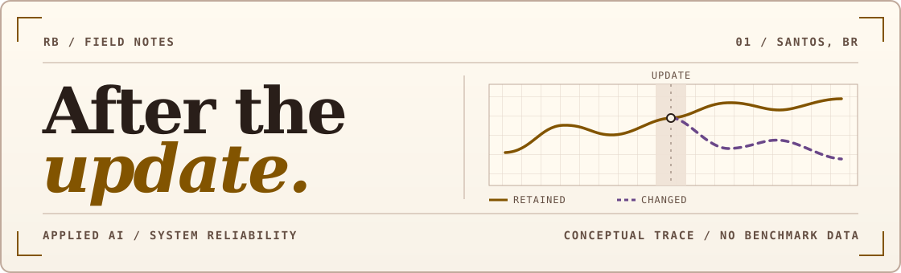

# Roberto Braga

<picture>
  <source media="(prefers-color-scheme: dark)" srcset="./assets/editorial-dark.svg">
  <source media="(prefers-color-scheme: light)" srcset="./assets/editorial-light.svg">
  
</picture>

## I build AI systems for the moments when the happy path ends.

I'm an Applied AI & Automation Engineer at Cubic³, based in Brazil. I work across LLM evaluation and service automation. The question I keep coming back to: **what changes when the model changes?**

A score should tell you what broke. A workflow should tell you why it declined to act. I build small, inspectable experiments around both.

### 01 / Run the field note

**[Open the Workflow Replay Lab →](https://betobraga.github.io/workflow-replay-lab/)**

Same document, new delivery. Replay four fictional events and inspect why the flow writes, skips, or routes to a human. No account or API key. [Read the source and tests](https://github.com/BetoBraga/workflow-replay-lab).

### 02 / Explore the work

| Project | Question | What you can inspect |
| --- | --- | --- |
| **[ContinualKit](https://github.com/BetoBraga/continualkit)** | What knowledge did an update leave behind? | An early-stage Python toolkit with a metric for mean forgetting across tasks. |
| **[EagleEye](https://github.com/BetoBraga/eagle-eye)** | How can a person inspect a model's visual prediction? | A small Streamlit and Detectron2 app that annotates images and exports the result. |

### 03 / Bring a case that breaks the rule

A new revision mistaken for a duplicate. A source that looks convincing but doesn't support the claim. An average score that hides a broken task.

[Propose a fictional replay case](https://github.com/BetoBraga/workflow-replay-lab/issues) with the smallest input that reproduces it and the decision you expect.

**[borerto.com ↗](https://borerto.com/)**
