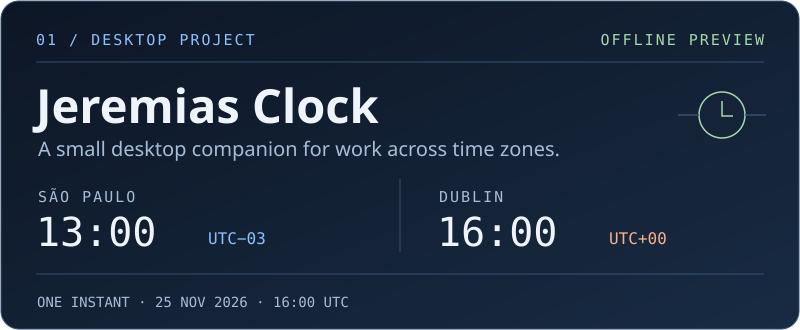

# Roberto Braga

Applied AI & Automation Engineer at Cubic³. I build software for people who work across time zones, teams, and systems that do not always agree.

## Leave the decision with the person.

A meeting moves. A focus block disappears. The person who notices usually has to repair the day by hand. I started with something smaller: getting two clocks to agree on one instant.

<picture>
  <source media="(prefers-color-scheme: dark)" srcset="assets/jeremias-dark.svg">
  <source media="(prefers-color-scheme: light)" srcset="assets/jeremias-light.svg">
  
</picture>

**[Try Jeremias on Windows →](https://github.com/BetoBraga/jeremias-clock#quick-start)** · [Follow the integration roadmap](https://github.com/BetoBraga/jeremias-clock/issues/11)

**What works today:** an offline desktop clock for São Paulo and Dublin. It handles daylight saving and lets you preview another time without changing the system clock.

**What I’m testing next:** a companion that can notice a scheduling conflict and draft a brief from notes you select. The goal is to show what it can access before it runs, explain what it found, and leave any calendar change for a person to approve. Calendar and agent integrations are not generally available.

**[Bring a scheduling edge case](https://github.com/BetoBraga/jeremias-clock/issues/11).** Start with a fictional meeting: what changed, what should the clock show, and when should the companion stay quiet?

## Other experiments

- **[ContinualKit](https://github.com/BetoBraga/continualkit):** what did the model forget after an update? An early tool for comparing task-level regressions.
- **[Workflow Replay Lab](https://betobraga.github.io/workflow-replay-lab/):** see why a workflow writes, skips, or asks for review across four fictional cases.

[borerto.com](https://borerto.com/)
