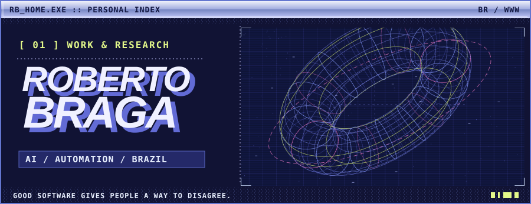
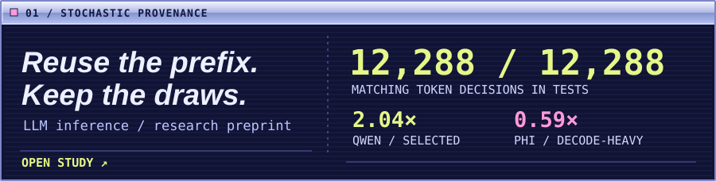
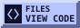
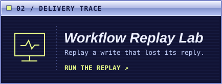
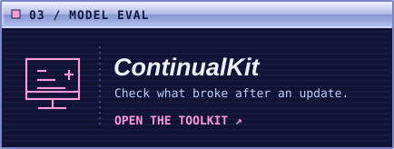
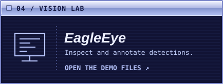
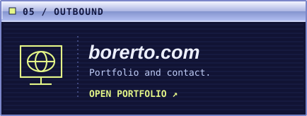

  

## Select a file

  

  
  
  

  

  

  

  

<strong>Open experiment log</strong>

Stochastic Provenance reuses one processed prefix without sharing random draws across branches. The tests matched 192 trajectories and 12,288 token decisions across three models and two numerical policies. On an RTX 5060 Ti, one selected Qwen workload ran at 2.04× baseline speed and used 46.7% less peak allocated GPU memory. A decode-heavy Phi case saved 28.2% of that memory but ran at 0.59× baseline speed. These are workload-specific results. [Explore the comparison](https://betobraga.github.io/stochastic-provenance/#findings) · [Read the evidence notes](https://github.com/BetoBraga/stochastic-provenance/blob/main/docs/evidence.md)

<strong>Try a failure case</strong>

In [Replay Lab](https://betobraga.github.io/workflow-replay-lab/), choose **Interrupt after durable write**, reload, and run **Interrupted delivery replay**. Predict how many writes the second delivery makes before opening **Inspect assertions**. [Send me a fictional case I missed](https://github.com/BetoBraga/workflow-replay-lab/issues).

<strong>Live repository widget</strong>

