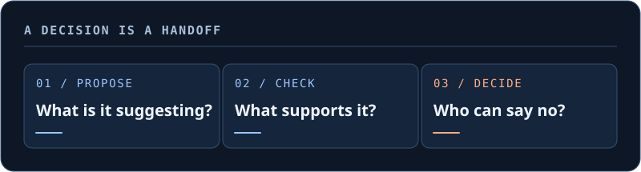

# Roberto Braga

Applied AI & Automation Engineer at Cubic³. I work on model evaluation and service automation.

## Good software gives people a way to disagree.

The interesting part starts after a model gives an answer. Someone has to work out what to trust, what to try again, and when to stop. I build from that moment backward: make the evidence visible, test what can change, and leave the person using the system a way to intervene.

<picture>
  <source media="(prefers-color-scheme: dark)" srcset="assets/decision-design-dark.svg">
  <source media="(prefers-color-scheme: light)" srcset="assets/decision-design-light.svg">
  
</picture>

What would make me hold a release?

A better average can hide a task that used to work. A convincing answer can point to a source that doesn't support it. A retry can quietly create a second record. Those are separate tests, and any one of them can be a reason to wait.

## Selected work

- **[Workflow Replay Lab](https://betobraga.github.io/workflow-replay-lab/):** four fictional document deliveries. Inspect why the workflow writes, skips, or asks for review.
- **[ContinualKit](https://github.com/BetoBraga/continualkit):** an early toolkit for measuring what a model forgets after an update. See the [critical-task gate in review](https://github.com/BetoBraga/continualkit/pull/8).

**What would you make it fail on?** [Send a fictional test case](https://github.com/BetoBraga/workflow-replay-lab/issues) and say what the system should do instead.

[borerto.com](https://borerto.com/)
